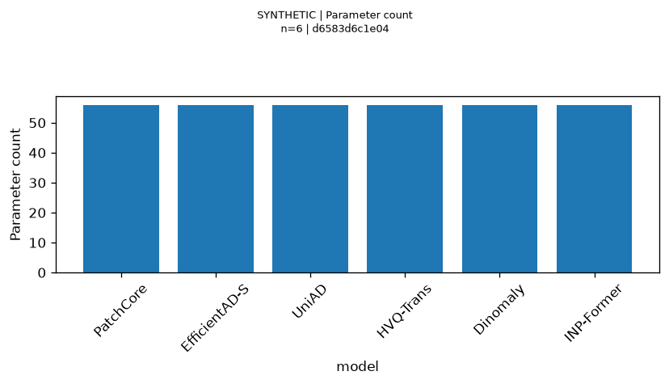
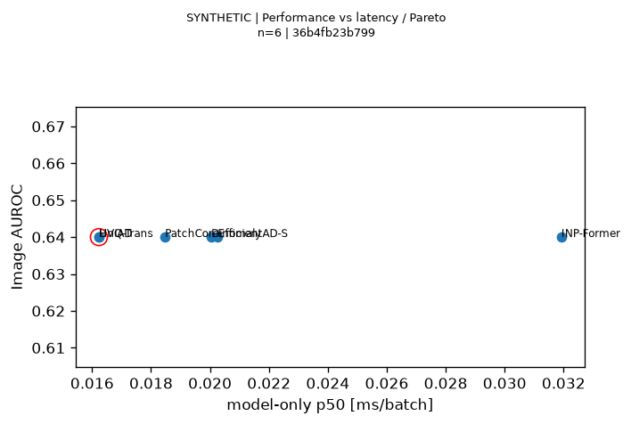
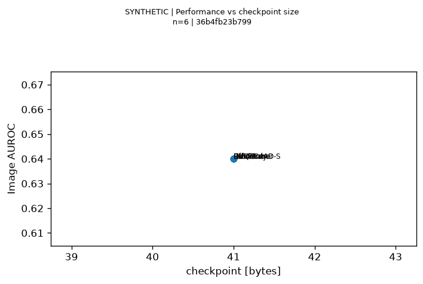
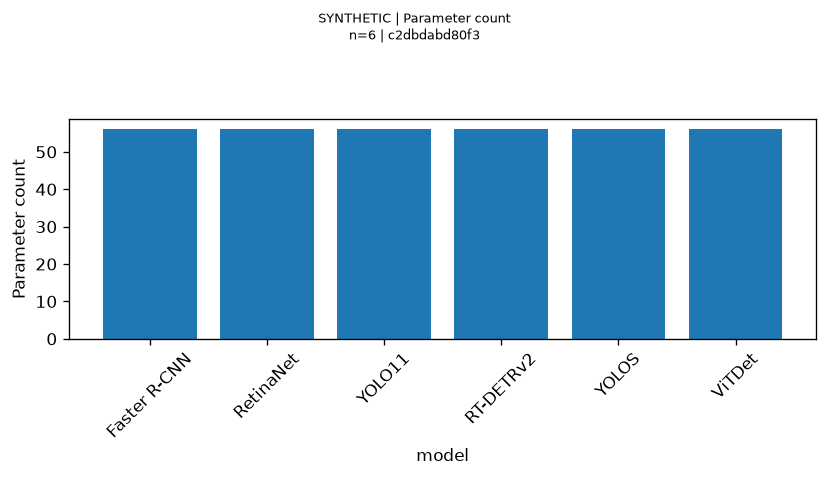
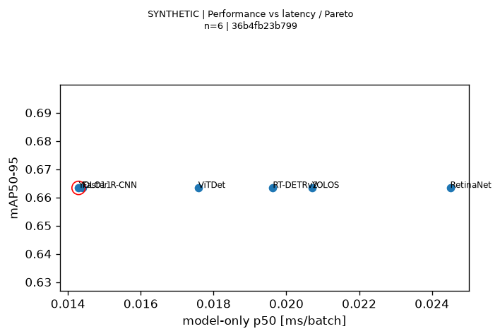
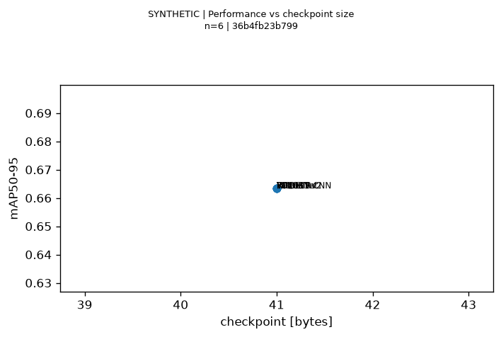

# 모델 비교 보고서

직접 비교는 데이터·주석·평가집합·프로토콜·비교조건이 같은 그룹 안에서만 허용한다. SYNTHETIC은 실제 성능과 분리한다.

대표 Run: Validation Image AUROC(이상탐지) 또는 Validation mAP50-95(검출) 최대, 동률이면 run_id 사전순. Test 점수로 선택하지 않는다.

## 그룹 1: anomaly / SYNTHETIC / COMMON_INPUT

동일 조건 해시: `d6583d6c1e04741207301c51e04c2beba21b59ea384c93c8cd64e94e429cfbed`

| model | run | image AUROC / mAP50-95 | image AP / mAP50 | pixel AUROC | pixel AP | AUPRO | F1 | benchmark subject |

|---|---|---:|---:|---:|---:|---:|---:|---|

| PatchCore | run_20261113T023500_51fe8b28a30e477c968f5fbd34365ec1 | 0.64 | 0.74 | 0.777778 | 0.548374 | 0.664726 | 0.8 | SYNTHETIC_TINY_CONV_NOT_OFFICIAL_MODEL |

| EfficientAD-S | run_20261113T023535_b50b31f688e9449e9f67fc9e19018bd2 | 0.64 | 0.74 | 0.777778 | 0.548374 | 0.664726 | 0.8 | SYNTHETIC_TINY_CONV_NOT_OFFICIAL_MODEL |

| UniAD | run_20261113T023538_c652c9a6b4594c1998657bb1850ae336 | 0.64 | 0.74 | 0.777778 | 0.548374 | 0.664726 | 0.8 | SYNTHETIC_TINY_CONV_NOT_OFFICIAL_MODEL |

| HVQ-Trans | run_20261113T023543_d002d3fd9db241d7a13e91ff5bee5946 | 0.64 | 0.74 | 0.777778 | 0.548374 | 0.664726 | 0.8 | SYNTHETIC_TINY_CONV_NOT_OFFICIAL_MODEL |

| Dinomaly | run_20261113T023548_7b76095085fc42f7a597c4cee8a04565 | 0.64 | 0.74 | 0.777778 | 0.548374 | 0.664726 | 0.8 | SYNTHETIC_TINY_CONV_NOT_OFFICIAL_MODEL |

| INP-Former | run_20261113T023552_c89ea23171934273b2541829a9c2063c | 0.64 | 0.74 | 0.777778 | 0.548374 | 0.664726 | 0.8 | SYNTHETIC_TINY_CONV_NOT_OFFICIAL_MODEL |

![Checkpoint size [bytes]](figures_5c811ce220/group1_checkpoint_comparison.png)

속도 비교는 1개 하드웨어·batch·입력 집합·dtype 그룹으로 분리했다. 서로 다른 그룹의 속도를 한 순위로 합치지 않는다.

동일 hardware·batch·입력 집합에서의 관측이다. 합성 점은 모델 채택 근거가 아니다.

동일 hardware·batch·입력 집합에서의 관측이다. 합성 점은 모델 채택 근거가 아니다.

Peak GPU VRAM: NOT_MEASURED

## 그룹 2: detection / SYNTHETIC / COMMON_INPUT

동일 조건 해시: `c2dbdabd80f3a7711e37642e3b09e2e454d6aeb0a08225cbe0b415f19172d33a`

| model | run | image AUROC / mAP50-95 | image AP / mAP50 | pixel AUROC | pixel AP | AUPRO | F1 | benchmark subject |

|---|---|---:|---:|---:|---:|---:|---:|---|

| Faster R-CNN | run_20261113T023557_f6c22a2fe9c84aa79b434cac630c9d6b | 0.663366 | 0.663366 | N/A | N/A | N/A | 0.666667 | SYNTHETIC_TINY_CONV_NOT_OFFICIAL_MODEL |

| RetinaNet | run_20261113T023603_34239ec0d2354e9a9f614064484025a6 | 0.663366 | 0.663366 | N/A | N/A | N/A | 0.666667 | SYNTHETIC_TINY_CONV_NOT_OFFICIAL_MODEL |

| YOLO11 | run_20261113T023608_274d81958c664ae2bfbfecb620fbf737 | 0.663366 | 0.663366 | N/A | N/A | N/A | 0.666667 | SYNTHETIC_TINY_CONV_NOT_OFFICIAL_MODEL |

| RT-DETRv2 | run_20261113T023610_b6ed925295864ae1ad0404f84448aa15 | 0.663366 | 0.663366 | N/A | N/A | N/A | 0.666667 | SYNTHETIC_TINY_CONV_NOT_OFFICIAL_MODEL |

| YOLOS | run_20261113T023613_37bb6faea96b43c1b17587445dd4ac9c | 0.663366 | 0.663366 | N/A | N/A | N/A | 0.666667 | SYNTHETIC_TINY_CONV_NOT_OFFICIAL_MODEL |

| ViTDet | run_20261113T023615_3e00e50b79784ad6b8c9114f8e5bb4b6 | 0.663366 | 0.663366 | N/A | N/A | N/A | 0.666667 | SYNTHETIC_TINY_CONV_NOT_OFFICIAL_MODEL |

![Checkpoint size [bytes]](figures_5c811ce220/group2_checkpoint_comparison.png)

속도 비교는 1개 하드웨어·batch·입력 집합·dtype 그룹으로 분리했다. 서로 다른 그룹의 속도를 한 순위로 합치지 않는다.

동일 hardware·batch·입력 집합에서의 관측이다. 합성 점은 모델 채택 근거가 아니다.

동일 hardware·batch·입력 집합에서의 관측이다. 합성 점은 모델 채택 근거가 아니다.

Peak GPU VRAM: NOT_MEASURED

## 제외·미완료 Run

| 항목 | 관측값 |
|---|---|

## 한계

실제 모델 성능과 다른 GPU의 속도를 혼합하지 않는다. 학습 GPU가 다르면 학습 시간/학습 Peak VRAM은 동일 하드웨어 순위가 아니다.
