# SYNTHETIC 실험 보고서 — EfficientAD-S

Run `run_20261113T023535_b50b31f688e9449e9f67fc9e19018bd2` / 상태 **PARTIAL** / 실제 학습 실행 `False`

SYNTHETIC이면 모든 점수·Loss·예측 예시는 인프라 검증용이며 실제 모델 성능으로 해석하면 안 된다.

## 1. 실험 개요

| 항목 | 관측값 |
|---|---|
| experiment_id | shared-infrastructure-demo |
| run_id | run_20261113T023535_b50b31f688e9449e9f67fc9e19018bd2 |
| model_family | anomaly |
| data_kind | SYNTHETIC |
| comparison_track | COMMON_INPUT |

## 2. 모델 및 공식 구현

| 항목 | 관측값 |
|---|---|
| model_name | EfficientAD-S |
| official_repo | https://github.com/nelson1425/EfficientAD |
| official_commit | fcab5146f84ae17597044ad5ddf1656ccf805401 |
| project_commit | 8ee73b42b4c5e0552696d439c439623dff6c8531 |

## 3. 데이터와 Manifest 버전

| 항목 | 관측값 |
|---|---|
| manifest_sha256 | 105a0760f9289ad0ce31d3059959c28b9c376ae24cc5730d9d399ce20cf2c9af |
| annotation_sha256 | 9838f606e7b213b1d0df26c7f04a16b2cd4206c0142d285eb0485af77cf2abe2 |
| evaluation_set_sha256 | 47f89b7f35340818cdd8161f3f2064fac261a1f8329f84c78bac129f2028e024 |
| class_mapping_sha256 | 3eb04b1f75446bc6ef66389ae760388662e31a89a07fc5cc04bd22fd3954b1d6 |
| split_version | synthetic-fixed-v1 |
| crop_policy_version | no_crop_synthetic |
| model_adapter_version | synthetic-demo-v1 |

## 4. 학습 환경

| 항목 | 관측값 |
|---|---|
| python | 3.12.14 |
| system | Linux-6.18.33.2-microsoft-standard-WSL2-x86_64-with-glibc2.39 |
| cpu | 12th Gen Intel(R) Core(TM) i5-12400 |
| logical_cpus | 4 |
| ram_bytes | 10429767680 |
| torch_version | 2.15.0+cpu |
| cuda_version | N/A |
| gpu | [] |
| torch_threads | 1 |

## 5. 학습 설정

| 항목 | 관측값 |
|---|---|
| seed | 17 |
| device | cpu |
| batch_size | 1 |
| epochs | 0 |
| optimizer | N/A |
| scheduler | N/A |
| learning_rate | N/A |
| input_resolution | [24, 24] |
| normalization | synthetic RGB float01 |

기록된 checkpoint 메타데이터(가중치 파일은 별도 전달):

| 항목 | 관측값 |
|---|---|
| 0 | {'path': 'synthetic_checkpoint.bin', 'sha256': '702b18d9d885274576226b38b05b66892726908b711da417b8ec7fbc5e07d2e3', 'bytes': 41, 'epoch': None, 'role': 'SYNTHETIC_NOT_TRAINED', 'time_utc': '2026-11-13T02:35:35.379467+00:00'} |

## 6. Loss 분석

- 관측: loss_total Train 처음 1 → 마지막 0.333333. Loss 감소는 모델 성능 개선 증명이 아니다.
- 관측: loss_auxiliary Train 처음 0.2 → 마지막 0.0666667. Loss 감소는 모델 성능 개선 증명이 아니다.
- 관측: Validation image_auroc 최고값 0.9, epoch=2. Test로 선정하지 않았다.

## 7. Validation 성능

| 항목 | 관측값 |
|---|---|
| image_n | 10 |
| image_auroc | 0.64 |
| image_ap | 0.74 |
| image_precision | 0.8 |
| image_recall | 0.8 |
| image_f1 | 0.8 |
| pixel_n | 4608 |
| pixel_auroc | 0.777778 |
| pixel_ap | 0.548374 |
| pixel_precision | 0.818182 |
| pixel_recall | 0.666667 |
| pixel_f1 | 0.734694 |
| pixel_method | HISTOGRAM_APPROX_2048_VALIDATION_FROZEN_RANGE |
| pixel_score_range | [4.847305717703421e-06, 0.949999988079071] |
| scores_below_validation_range | 0 |
| scores_above_validation_range | 0 |
| aupro | 0.664726 |
| pixel_exclusions | 2 |
| positive_pixels_outside_fixed_scope | 0 |
| threshold_policy | {'image': 0.8, 'pixel': 0.8498051880756314, 'pixel_score_range': [4.847305717703421e-06, 0.949999988079071], 'detection': None, 'source_split': 'validation', 'validation_ids_sha256': '9656b3b87e552a6329eb9168389e6b536b517ad05487ea37ce4a9955372fae7b', 'protocol_sha256': '582a7377118d32cb2b0397e5416211702445796d92deb4aaf11086d3a4decab7', 'data_kind': 'SYNTHETIC'} |
| validation_product_count | 2 |

## 8. Test 성능

| 항목 | 관측값 |
|---|---|
| image_n | 10 |
| image_auroc | 0.64 |
| image_ap | 0.74 |
| image_precision | 0.8 |
| image_recall | 0.8 |
| image_f1 | 0.8 |
| pixel_n | 4608 |
| pixel_auroc | 0.777778 |
| pixel_ap | 0.548374 |
| pixel_precision | 0.818182 |
| pixel_recall | 0.666667 |
| pixel_f1 | 0.734694 |
| pixel_method | HISTOGRAM_APPROX_2048_VALIDATION_FROZEN_RANGE |
| pixel_score_range | [4.847305717703421e-06, 0.949999988079071] |
| scores_below_validation_range | 0 |
| scores_above_validation_range | 0 |
| aupro | 0.664726 |
| pixel_exclusions | 2 |
| positive_pixels_outside_fixed_scope | 0 |
| threshold_policy | {'image': 0.8, 'pixel': 0.8498051880756314, 'pixel_score_range': [4.847305717703421e-06, 0.949999988079071], 'detection': None, 'source_split': 'validation', 'validation_ids_sha256': '9656b3b87e552a6329eb9168389e6b536b517ad05487ea37ce4a9955372fae7b', 'protocol_sha256': '582a7377118d32cb2b0397e5416211702445796d92deb4aaf11086d3a4decab7', 'data_kind': 'SYNTHETIC'} |
| validation_product_count | 2 |

## 9. 클래스별 성능

| 항목 | 관측값 |
|---|---|

## 10. 품목·시점별 성능

| 항목 | 관측값 |
|---|---|
| synthetic_product | {'n': 10, 'auroc': 0.6400000000000001, 'ap': 0.7400000000000001, 'precision': 0.8, 'recall': 0.8, 'f1': 0.8} |

| 항목 | 관측값 |
|---|---|
| C1 | {'n': 2, 'auroc': 1.0, 'ap': 1.0, 'precision': 1.0, 'recall': 1.0, 'f1': 1.0} |
| C2 | {'n': 2, 'auroc': 0.0, 'ap': 0.5, 'precision': 0.5, 'recall': 1.0, 'f1': 0.6666666666666666} |
| C3 | {'n': 2, 'auroc': 0.0, 'ap': 0.5, 'precision': 0.0, 'recall': 0.0, 'f1': 0.0} |
| C4 | {'n': 2, 'auroc': 1.0, 'ap': 1.0, 'precision': 1.0, 'recall': 1.0, 'f1': 1.0} |
| C5 | {'n': 2, 'auroc': 1.0, 'ap': 1.0, 'precision': 1.0, 'recall': 1.0, 'f1': 1.0} |

## 11. 예측 이미지와 그래프

### Train / Validation loss

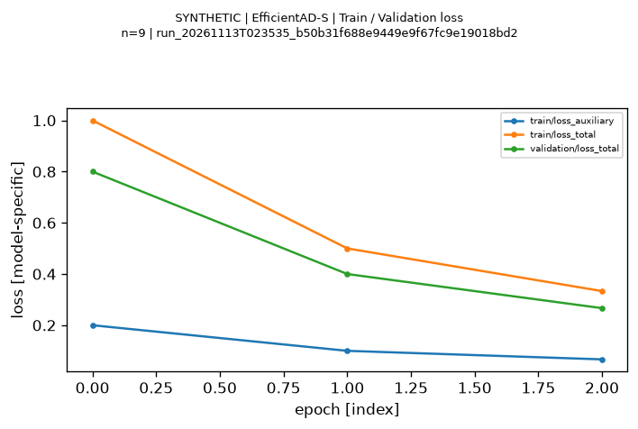

관측 이력만 표시. 합성 Run의 곡선은 실제 학습 결과가 아니다.

### Loss components

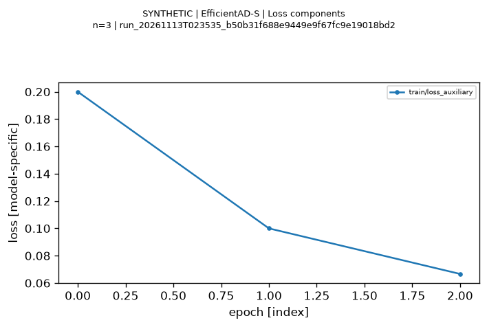

관측 이력만 표시. 합성 Run의 곡선은 실제 학습 결과가 아니다.

### Learning rate

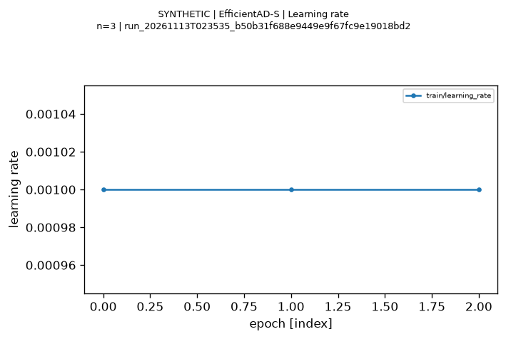

관측 이력만 표시. 합성 Run의 곡선은 실제 학습 결과가 아니다.

### Gradient norm


관측 이력만 표시. 합성 Run의 곡선은 실제 학습 결과가 아니다.

### Epoch duration

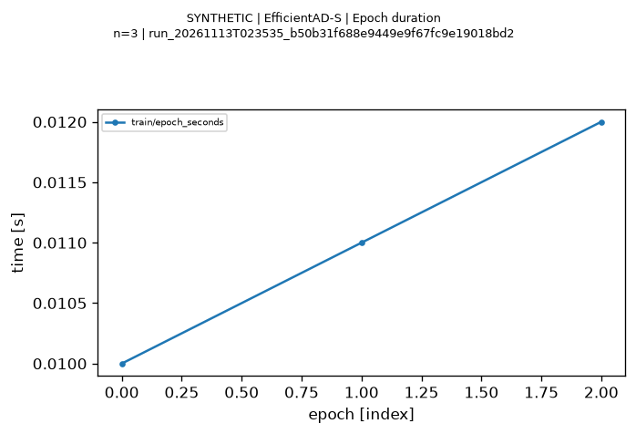

관측 이력만 표시. 합성 Run의 곡선은 실제 학습 결과가 아니다.

### Validation metrics

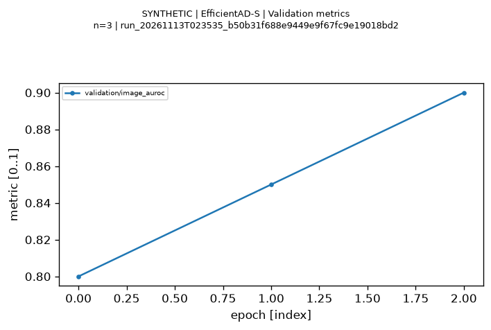

관측 이력만 표시. 합성 Run의 곡선은 실제 학습 결과가 아니다.

### validation image ROC

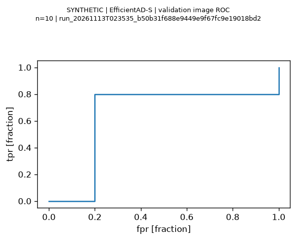

동일 GT 범위에서 계산. Pixel 곡선은 고정 Validation 구간 2048-bin 근사다.

### validation image PR

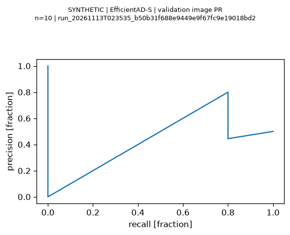

동일 GT 범위에서 계산. Pixel 곡선은 고정 Validation 구간 2048-bin 근사다.

### validation pixel ROC

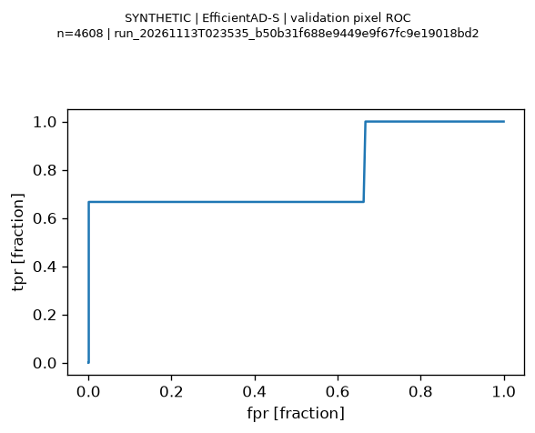

동일 GT 범위에서 계산. Pixel 곡선은 고정 Validation 구간 2048-bin 근사다.

### validation pixel PR

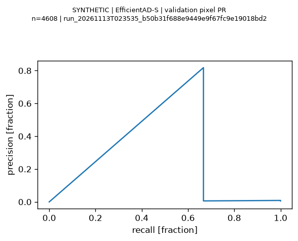

동일 GT 범위에서 계산. Pixel 곡선은 고정 Validation 구간 2048-bin 근사다.

### AUPRO

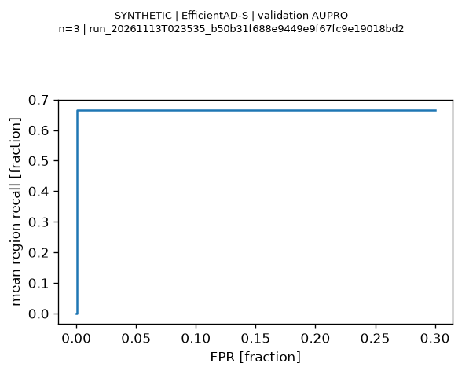

영역 동일 가중, FPR0~0.3 정규화. 실제 모델 검출률과 혼용하지 않는다.

### validation category

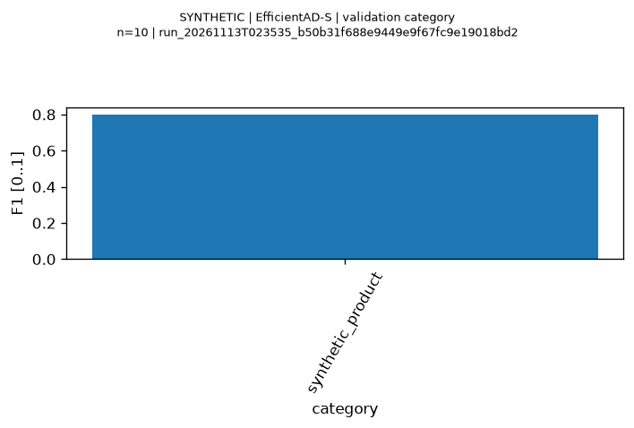

고정 Validation Threshold의 그룹별 F1. 단일/소량 표본은 일반화 근거가 부족하다.

### validation view


고정 Validation Threshold의 그룹별 F1. 단일/소량 표본은 일반화 근거가 부족하다.

### test image ROC


동일 GT 범위에서 계산. Pixel 곡선은 고정 Validation 구간 2048-bin 근사다.

### test image PR

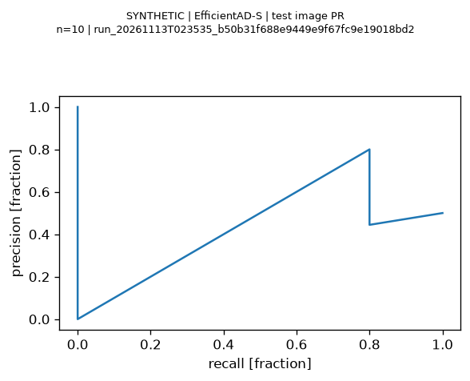

동일 GT 범위에서 계산. Pixel 곡선은 고정 Validation 구간 2048-bin 근사다.

### test pixel ROC

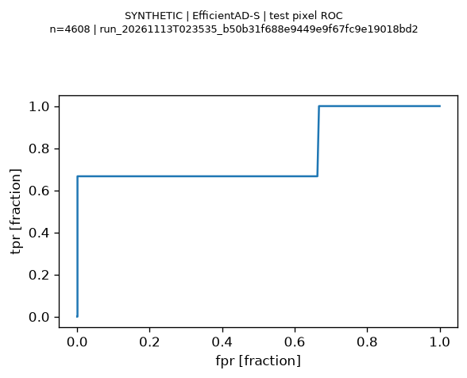

동일 GT 범위에서 계산. Pixel 곡선은 고정 Validation 구간 2048-bin 근사다.

### test pixel PR


동일 GT 범위에서 계산. Pixel 곡선은 고정 Validation 구간 2048-bin 근사다.

### AUPRO

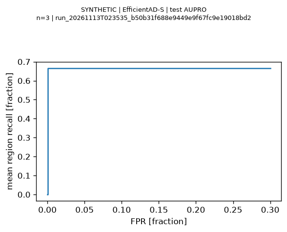

영역 동일 가중, FPR0~0.3 정규화. 실제 모델 검출률과 혼용하지 않는다.

### test category

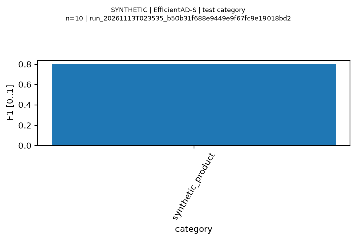

고정 Validation Threshold의 그룹별 F1. 단일/소량 표본은 일반화 근거가 부족하다.

### test view

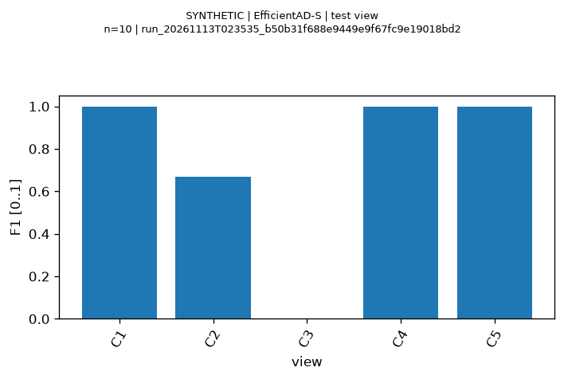

고정 Validation Threshold의 그룹별 F1. 단일/소량 표본은 일반화 근거가 부족하다.

### Score distribution

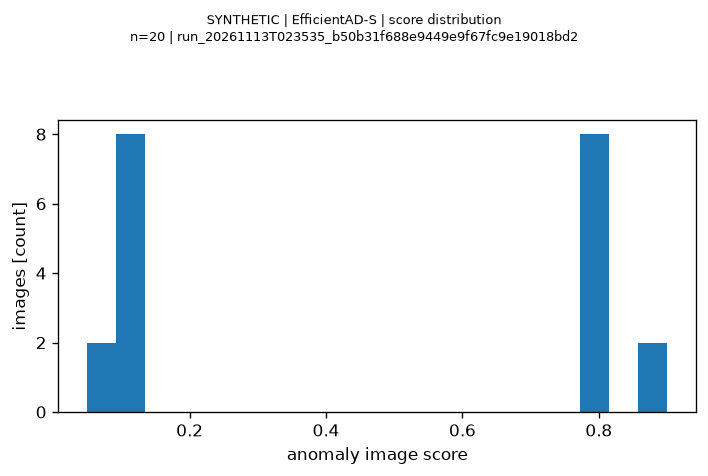

예측 점수의 분포이며 정답 라벨이나 성능 그 자체가 아니다.

### Latency distribution

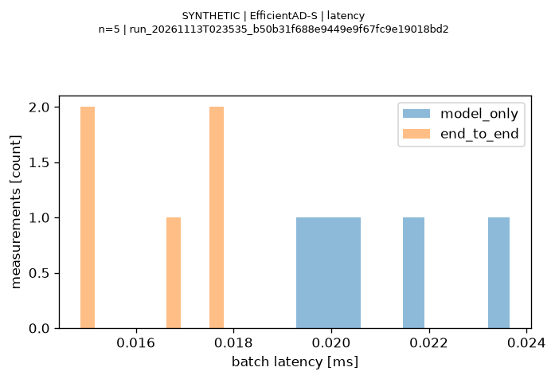

전처리/후처리를 분리했다. 다른 GPU나 batch/input 집합과 속도 순위를 합치지 않는다.

### Run / stability events

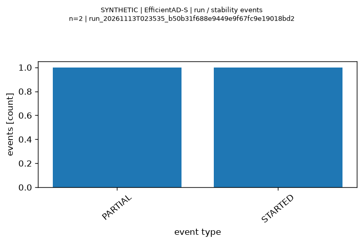

NaN/Inf·중단·예외 등 관측 사건이다. 사건이 없다고 실제 학습 안정성이 입증된 것은 아니다.

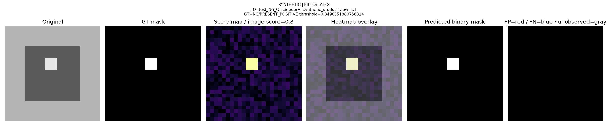

내부 검토용 예측 예시. 제목의 SYNTHETIC/REAL 출처와 GT 제공 여부를 확인한다.

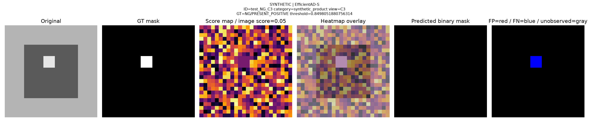

내부 검토용 예측 예시. 제목의 SYNTHETIC/REAL 출처와 GT 제공 여부를 확인한다.

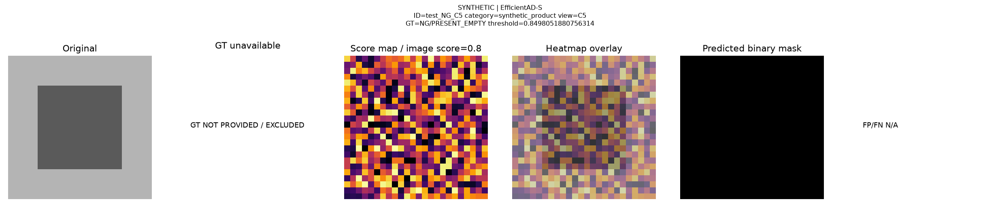

내부 검토용 예측 예시. 제목의 SYNTHETIC/REAL 출처와 GT 제공 여부를 확인한다.

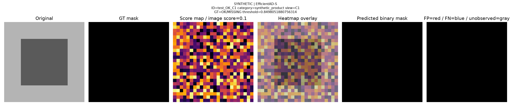

내부 검토용 예측 예시. 제목의 SYNTHETIC/REAL 출처와 GT 제공 여부를 확인한다.

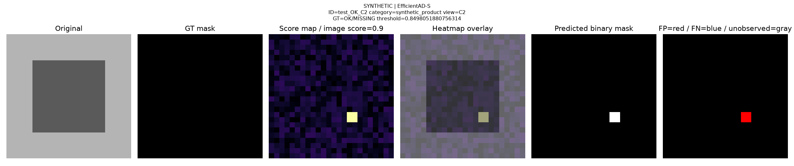

내부 검토용 예측 예시. 제목의 SYNTHETIC/REAL 출처와 GT 제공 여부를 확인한다.

## 12. FP/FN 및 실패 사례

| 항목 | 관측값 |
|---|---|
| tp | N/A |
| fp | N/A |
| fn | N/A |
| pixel_exclusions | [{'image_id': 'test_NG_C4', 'reason': 'NG_MISSING'}, {'image_id': 'test_NG_C5', 'reason': 'NG_PRESENT_EMPTY'}] |
| exclusions | N/A |

## 13. 추론 속도

| 항목 | 관측값 |
|---|---|
| subject | SYNTHETIC_TINY_CONV_NOT_OFFICIAL_MODEL |
| model_only | {'mean_ms': 0.020922001567669213, 'p50_ms': 0.020266990759409964, 'p95_ms': 0.02324701054021716, 'samples_ms': [0.02365501131862402, 0.021615007426589727, 0.019785991753451526, 0.020266990759409964, 0.019287006580270827], 'repetitions': 5, 'batch_size': 1, 'throughput_images_s': 47796.57418367184, 'fps': 47796.57418367184} |
| end_to_end | {'mean_ms': 0.016445404617115855, 'p50_ms': 0.016785998013801873, 'p95_ms': 0.017765405937097967, 'samples_ms': [0.017793005099520087, 0.016785998013801873, 0.015122001059353352, 0.017655009287409484, 0.01487100962549448], 'repetitions': 5, 'batch_size': 1, 'throughput_images_s': 60807.260343064576, 'fps': 60807.260343064576} |
| stages | {'preprocess': {'mean_ms': 0.004959802026860416, 'p50_ms': 0.0052480027079582214, 'p95_ms': 0.0058444071328267455, 'samples_ms': [0.00537400774192065, 0.0052480027079582214, 0.004215995431877673, 0.005962006980553269, 0.003998997271992266], 'repetitions': 5, 'batch_size': 1, 'throughput_images_s': 201620.95071222144, 'fps': 201620.95071222144}, 'model': {'mean_ms': 0.010712401126511395, 'p50_ms': 0.010745992767624557, 'p95_ms': 0.011185603216290474, 'samples_ms': [0.011191004887223244, 0.010745992767624557, 0.010346004273742437, 0.011163996532559395, 0.010115007171407342], 'repetitions': 5, 'batch_size': 1, 'throughput_images_s': 93349.75307498222, 'fps': 93349.75307498222}, 'postprocess': {'mean_ms': 0.00039339938666671515, 'p50_ms': 0.00039099541027098894, 'p95_ms': 0.00042580359149724245, 'samples_ms': [0.0004249886842444539, 0.0004260073183104396, 0.000366999302059412, 0.0003580062184482813, 0.00039099541027098894], 'repetitions': 5, 'batch_size': 1, 'throughput_images_s': 2541946.0067618056, 'fps': 2541946.0067618056}} |
| model_load_seconds | 0.000297265 |
| hardware_sha256 | 36b4fb23b79993321ec8089bd317380eccc7c5339fe4dc22d2696e822064bf85 |
| batch_size | 1 |
| warmup | 2 |
| repetitions | 5 |
| input_set_sha256 | 6bdd3fa86a3d8053559cca0de38f72ae47a8eebf5e229ce633d9b532101e703b |

## 14. 모델 크기

| 항목 | 관측값 |
|---|---|
| parameters | 56 |
| trainable_parameters | 56 |
| checkpoint | {'bytes': 41, 'sha256': '702b18d9d885274576226b38b05b66892726908b711da417b8ec7fbc5e07d2e3'} |
| memory_bank_bytes | N/A |
| search_index_bytes | N/A |

## 15. 메모리

| 항목 | 관측값 |
|---|---|
| peak_cpu_rss_bytes | 479100928 |
| cpu_rss_baseline_bytes | 479096832 |
| cpu_rss_delta_bytes | 4096 |
| rss_measurement | sampled_process_RSS_5ms_not_exact_model_memory |
| gpu_memory | {'model_only': None, 'end_to_end': None} |

## 16. 실패와 한계

상태: PARTIAL. 실제 GPU·공식 모델 통합 여부는 별도 확인한다. 미측정 값은 N/A다.

| 항목 | 관측값 |
|---|---|
| missing_plots | [] |
| events | [{'time_utc': '2026-11-13T02:35:35.199924+00:00', 'event': 'STARTED'}, {'time_utc': '2026-11-13T02:35:36.399249+00:00', 'event': 'PARTIAL', 'training_executed': False}] |

## 17. 재현 명령어

```bash

uv run --locked python scripts/experiments/smoke_test_reporting.py

```

[설정](config.json) · [환경](environment.json) · [학습 이력](training_history.csv)
