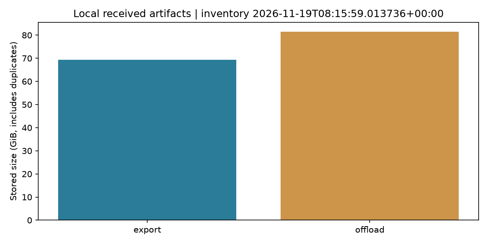

# Real-IAD 원격 학습·백업·모델별 종합 보고서
> **최신 상태는 18:03 KST 최종 재확인 절을 우선한다.** 최초 snapshot 이후 INP 14품목 완료, RT-DETRv2·YOLOS·ViTDet 활성화 등 변화가 있다.

점검 기준: 2026-11-19T08:15:59.013736+00:00 UTC. Git 동기화가 아닌 SSH/rsync와 실제 파일/로그를 점검했다.

## 핵심 판정

원격 GPU 학습은 진행 중이지만 **로컬 백업이 최신 학습 상태를 모두 포함하지 않는다.** 점검 시 A6000 GPU100%, 19,914MiB(약19.45GiB) 사용. 기존 수신 데이터는160,920,352,373bytes(약149.87GiB), PT416개다. 최초 점검 당시 pull_loop/rsync 프로세스를 확인하지 못했고 마지막 수신 흔적은16:48경이었다. 이후 변화는 최종 재확인 절을 따른다.

- 활성 모델5개 최신 체크포인트(Toy brick/Porcelain doll INP, v2 Faster R-CNN/RetinaNet/YOLO11)는 snapshot 기준 로컬에 동일 파일이 없었다.
- pull 스크립트는 export와 offload 큐만 읽는다. 현재 job_v2/진행 중 checkpoint는 아직 그 경로로 export되지 않아 큐가0이어도 최신 백업 완료가 아니다.
- PT416개 중413개는 ZIP 구조 정상,3개 파일(서로 다른 가중치2종)은 잘리거나 손상되어 구조 검사를 통과하지 못했다. 파일은 삭제하지 않았다.
- 동일 이름/크기 중복 후보197개, 추가 저장 약67.77GiB. 중복 전량 해시 검증/삭제는 하지 않았다.
- rsync 임시 파일4개 약2.18GiB도 남아 있어 전송 중단 이력이 있다. 현재 transfer가 실행 중이라는 뜻은 아니다.
- 기존 pull_realiad.sh는 서버 파일 삭제 기능이 있고, 큐 전송은 rsync 실패를 무시한 뒤 로컬 존재만으로 서버 삭제를 결정한다. 이 점검에서 해당 스크립트는 실행하지 않았다.

## 모델별 상태

|모델|현재 상태|후속 작업|
|---|---|---|
|[PatchCore](PATCHCORE_REPORT.md)|FIT_EVALUATION_COMPLETED|새 학습보다 메모리뱅크·설정·평가 결과 묶음 보존 및 재현 추론을 우선한다.|
|[EfficientAD-S](EFFICIENTAD_S_REPORT.md)|EVALUATION_AVAILABLE_WITH_RECOVERY|회복 평가 10품목과 PCB처럼 짧은 회복 학습을 별도 표시하고 calibration 붕괴 원인을 해결한 뒤 필요한 품목만 새 실험/안전한 checkpoint에서 이어간다.|
|[UniAD](UNIAD_REPORT.md)|TRAINED_50_EPOCH_EVALUATION_PAUSED|재학습보다 저장된 가중치의 스트리밍 Validation/Test 평가를 먼저 복구한다. NPY 전체 누적으로 디스크가 다시 차지 않도록 한다.|
|[HVQ-Trans](HVQ_TRANS_REPORT.md)|TRAINING_OR_END_OF_TRAINING_RETRY|50 epoch 종료 지점의 signal11/저장/평가 전환을 진단하고 가장 최근 유효 checkpoint로 평가부터 검증한다. 50 epoch 전체 반복을 자동 성공으로 세지 않는다.|
|[Dinomaly](DINOMALY_REPORT.md)|COMPLETION_RECEIPT_ARTIFACTS_INCOMPLETE|로컬 가중치와 정확한 설정을 먼저 묶고 평가·보고서를 재생성한다. 원본 경로 부재를 학습 실패나 모델 손상으로 단정하지 않는다.|
|[INP-Former](INP_FORMER_REPORT.md)|CATEGORY_TRAINING_IN_PROGRESS|현재 두 worker를 유지하고 남은 18품목(진행 중2 포함)을 이어간다. 완료 품목을 재학습하지 않고 각 best/설정/평가를 즉시 백업한다.|
|[Faster R-CNN](FASTER_RCNN_REPORT.md)|V2_TRAINING|현재 v2 학습을 이어가고 새 체크포인트와 best를 안전하게 수신한다. 이전 v1 class-error 결과를 현재 결과와 섞지 않는다.|
|[RetinaNet](RETINANET_REPORT.md)|V2_TRAINING|현재 lr0.0025 설정을 유지한 채 Validation 추이를 관찰하고 원래 발산한 lr0.01 실험과 분리한다. 단기 유한 Loss를 최종 성능으로 해석하지 않는다.|
|[YOLO11](YOLO11_REPORT.md)|V2_TRAINING|현재 v2 50 epoch를 이어가고 Validation으로 best를 고른다. v1 완료 수치를 최신 모델 최종 성능으로 보고하지 않는다.|
|[RT-DETRv2](RTDETRV2_REPORT.md)|ACTIVE_WORKER_CLASS_CONTRACT_UNVERIFIED|현재 실행 모델들의 GPU/메모리 여유가 생기면 고정된 v2 클래스/데이터 계약으로 새 실험을 시작한다. v1 가중치의 다른 head를 무조건 이어받지 않는다.|
|[YOLOS](YOLOS_REPORT.md)|ACTIVE_WORKER_CLASS_CONTRACT_UNVERIFIED|현재 v2 대기 순서대로 시작한다. class head가 바뀌는 초기화/재개 조건을 기록하고 v1 결과와 분리한다.|
|[ViTDet](VITDET_REPORT.md)|ACTIVE_WORKER_CLASS_CONTRACT_UNVERIFIED|GPU 여유와 공식 입력 제약을 확인한 뒤 v2 실행을 시작한다. 먼저 256 입력 설정이 공식 baseline과 다른 조건임을 기록한다.|

## 데이터·비교 조건 주의

현재 원격은30,000장 코호트다. 탐지 v2는111개 품목×결함 +30개 품목별 OK=141클래스이며 OK에 제품 영역 박스가 있다. 기존8결함-only D1와 동일하지 않다. 원격 source.json은30,000장 중 실제 축소 Crop713장/원본 유지29,287장이라고 기록한다. 로컬에서 진행한 새로운 전수 Crop 결과가 현재 학습에 자동 반영된 것은 아니다.

## 확인된 로컬 손상 파일

|파일|크기|판정|
|---|---:|---|
|`real-iad-backup/export/efficientad_s_recovery_20261117/toy/checkpoints/best_d2b8b489ffda4a6bbcda79d7543edebf.pt`|65,536|PK 헤더는 있으나 종료 구조 부재/잘린 ZIP. 재개 사용 금지, 유효한 다른 best/원격 보존본 대조 필요|
|`real-iad-backup/export/remaining_models_recovery_20261117/inp_former/checkpoints/best_71d91c2244ac4592a4a4d63ae244ff8c.pt`|620,521,084|PK 헤더는 있으나 종료 구조 부재/잘린 ZIP. 재개 사용 금지, 유효한 다른 best/원격 보존본 대조 필요|
|`real-iad-backup/offload/workspace/real-iad/outputs/remaining_models_recovery_20261117/job/inp_former/mounts/best_71d91c2244ac4592a4a4d63ae244ff8c.pt`|620,521,084|PK 헤더는 있으나 종료 구조 부재/잘린 ZIP. 재개 사용 금지, 유효한 다른 best/원격 보존본 대조 필요|

## 체크섬 점검 범위

참조·manifest SHA256 55건/고유55파일 확인, 불일치0건. 전체 PT 전수 검증은 아니다.

## 추론 코드·실행 결과

[scripts/inference/run_checkpoint.py](../../scripts/inference/run_checkpoint.py)를 구현했다. 실제 실행은EfficientAD-S/RetinaNet/YOLO11/Faster R-CNN 각2장, 총8장이다. 나머지8모델의 실제 추론 통합은 UNVERIFIED/NOT_EXECUTED다. 일부 모델은 native memory bank/checkpoint 계약이 달라 추가 검증이 필요하다.

시연에서 YOLO11은 NG/OK 각1장에 해당 객체를 예측했고, Faster R-CNN은NG에도 정상 객체만 예측했으며, RetinaNet은 표시 threshold 이상 검출이 없었다. EfficientAD는 정상1장을NG로 판정했다. 이것은 각2장 시연이며 전체 모델 순위나 최종 성능이 아니다.

## 남은 작업 순서

1. 최신 closed checkpoint와 request/config/class mapping을 삭제 없는 동기화로 먼저 보존한다. 학습 중 파일을 임의 삭제하거나 덮어쓰지 않는다.
2. 현재 실행 중 v2 탐지3개와 INP2 worker를 유지하고 추가 모델의 동시 실행을 늘리지 않는다. GPU가 이미 포화다.
3. HVQ 종료 signal11와 UniAD 평가·디스크 문제를 복구하여 기존 가중치를 재사용한다.
4. Dinomaly의 누락 평가 자료를 복구하거나 저장된 checkpoint로 다시 평가해 보고서를 완성한다.
5. v2 데이터·클래스 정책을 확인한 뒤 RT-DETRv2/YOLOS/ViTDet 대기 실행을 진행한다.
6. 모든 모델의 동일 Manifest/평가 계약과 같은 하드웨어 benchmark를 맞춘 후 최종 비교한다.

세부 증거: [로컬 점검](../../outputs/remote_training_audit_20261119_v1/local_backup_audit.json), [ZIP 구조 검사](../../outputs/remote_training_audit_20261119_v1/checkpoint_container_validation.json), [수집 설정](../../outputs/remote_training_audit_20261119_v1/remote_targeted.json).

## 최종 재확인 — 2026-11-19 18:03 KST

최초 17:10~17:16 점검 이후에도 학습·수신 상태가 변했다. 아래 상태가 앞선 snapshot 설명보다 우선한다. [최신 원격 원본](../../outputs/remote_training_audit_20261119_v1/remote_refresh.json).

- 18:02 KST: A6000 GPU 99%, VRAM 45,517/49,140 MiB, 디스크 여유 약54GB. 추가 학습 worker가 기존 자동 실행기에 의해 시작됐다. 이 점검에서 시작한 작업이 아니다.
- INP-Former 완료 영수증 **14/30품목**. toy_brick·porcelain_doll도 완료했으며 현재 transistor1·regulator를 학습 중이다. 나머지16품목에는 현재 진행 중2품목이 포함된다. 로컬에서 확보한 품목별 평가 수치는 이보다 앞선 **13품목**이다.
- YOLO11 v2 저장 checkpoint **11 epoch,57,882step**. Faster R-CNN v2 **완료 epoch2,14,200step(3번째 epoch 진행)**. RetinaNet v2 **완료 epoch1,6,900step(2번째 epoch 진행)**. 진행 중 step과 완료 epoch는 구분한다.
- RT-DETRv2·YOLOS·ViTDet worker가 새로 활성화됐다. 실행 request가 snapshot 코드와 job 경로를 사용하므로 이전 v1과 동일한 클래스인지, 수정 계약인지 추가 확인 전 **클래스 계약 UNVERIFIED**다. 단순히 모두 v2로 바뀌었다고 해석하지 않는다.
- HVQ-Trans는 재시작 후 **48/50,22,801/23,950iter** 로그다. 앞서50/50로그가 있어도 최종 완료 영수증/평가가 없으며 반복 재실행 이력이 있다.
- 최초 점검 이후 로컬 INP toy_brick metrics가17:35에 추가 수신된 것도 확인했다. 따라서 최초 수신 시각16:48/프로세스 부재만으로 현재 동기화가 계속 멈췄다고 단정할 수 없다. 다만 export/offload큐에 포함되지 않은 활성 checkpoint의 자동 보존은 여전히 보장되지 않는다.

### 확인한 SHA256 범위

참조·export manifest 기반 **55건 / 고유 파일55개 / 불일치0건**이다. 이 범위의 해시는 일치한다. 별도 구조 검사에서 확인한 손상3개 파일은 이 검증 집합 밖에 있으며, 전체416개가 모두 정상이라는 뜻이 아니다.

## 로컬 최종 파일 확인

[최신 로컬 파일 및 원격 checkpoint 대조](../../outputs/remote_training_audit_20261119_v1/local_refresh.json)

현재 로컬 파일 1983개, 153.74GiB, 마지막 변경 2026-11-19T17:58:53.261530+09:00. 최신 원격 참조는 그 시점 로컬 파일명/크기와 별도 대조했다. 동일 파일명/크기는 해시 일치를 대신하지 않는다.

[실제 추론 사용법과 8장 비교 이미지](INFERENCE_GUIDE_AND_EXAMPLES.md)

[18:03 원격 체크포인트와 최신 로컬 수신 대조 CSV](LATEST_CHECKPOINT_SYNC_STATUS.csv)

## 테스트 및 산출물 확인

추론 계약8개 + 기존 실험 인프라 회귀40개 = **48 passed,0 failed**(65.51초). 전체 프로젝트 pytest는 이번 점검에서 실행하지 않았다. 실제 CPU 추론4모델×2장,PNG8개 디코딩 검사,보고서 상대 링크 검사(누락0)를 완료했다. Python 구문 검사와 git diff --check도 통과했다.

실행: `uv run --offline pytest -q tests/test_checkpoint_inference.py tests/test_experiment_infrastructure.py`
