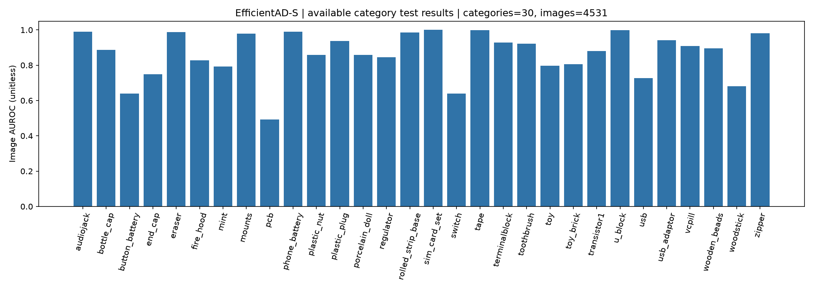

# EfficientAD-S 모델별 종합 보고서
> **최신 상태는 18:03 KST 최종 재확인 절을 우선한다.** 최초 snapshot 이후 INP 14품목 완료, RT-DETRv2·YOLOS·ViTDet 활성화 등 변화가 있다.

확인 시점: 2026-11-19T08:15:59.013736+00:00 (UTC). 원격 학습 상태는 이후 계속 변한다. 이 보고서가 학습이나 Test 평가를 새로 실행한 것은 아니다.

## 현재 상태

**EVALUATION_AVAILABLE_WITH_RECOVERY** — 30/30 품목 평가 있음. 20건 EVALUATION_COMPLETED, 10건 EVALUATION_RECOVERED. 모든 품목 50 epoch 완료를 뜻하지 않음.

## 학습·데이터 조건

원격 주 실험 코호트는 30,000장 /6,000 선언 제품 /30품목이며 Train21,045·Validation4,400·Test4,555이다. 전체151,050장 전수 학습 결과가 아니다. v1/v2는 같은 코호트 경로를 사용해도 Crop/클래스 계약이 다를 수 있다.

|설정|관측된 값(복수 Run 포함)|
|---|---|
|official_repo|"https://github.com/nelson1425/EfficientAD"|
|official_commit|"fcab5146f84ae17597044ad5ddf1656ccf805401"|
|manifest_sha256|"02db94ccda58921575b94d18c70d5064327c4608a9b58bfc6d78d9004f993c55"|
|split_version|"v2-preserved"|
|crop_policy_version|"provided-preprocessing-csv-saved-coordinates"|
|epochs|50|
|batch_size|1; 8|
|optimizer|"Adam"|
|learning_rate|0.0001|
|input_resolution|[256, 256]|

## 확보된 평가 수치

아래는 **확보된 품목들의 category macro 평균**이다. 모든 이미지 점수를 합쳐 다시 계산한 pooled AUROC가 아니며, 서로 다른 데이터/전처리 Run 간 성능 순위를 뜻하지 않는다.

|품목 수|Test 이미지 합|Image AUROC macro|Image AP macro|Image F1 macro|Pixel AUROC macro|AUPRO macro|
|---:|---:|---:|---:|---:|---:|---:|
|30|4531|0.864114|0.762399|0.692450|0.853888|0.683572|

|품목|Val AUROC|Test AUROC|Test AP|Test F1|Pixel AUROC|AUPRO|Test n|
|---|---:|---:|---:|---:|---:|---:|---:|
|audiojack|0.959259|0.988947|0.952578|0.844444|0.998619|0.989899|115.000000|
|bottle_cap|0.812059|0.887075|0.717454|0.648148|0.962051|0.876941|140.000000|
|button_battery|0.693571|0.639111|0.569050|0.525424|0.578129|0.203058|140.000000|
|end_cap|0.676070|0.749349|0.776811|0.684783|0.660544|0.376170|130.000000|
|eraser|0.984444|0.987143|0.972211|0.900000|0.996817|0.981313|145.000000|
|fire_hood|0.929683|0.828116|0.697046|0.596491|0.924725|0.563789|145.000000|
|mint|0.903158|0.791958|0.638611|0.507042|0.925388|0.733982|150.000000|
|mounts|0.975556|0.978333|0.943789|0.794521|0.983650|0.945166|160.000000|
|pcb|0.572500|0.493697|0.441418|0.603960|0.209962|0.011555|155.000000|
|phone_battery|0.990000|0.989758|0.975017|0.880952|0.986965|0.966500|160.000000|
|plastic_nut|0.937083|0.858056|0.659216|0.549020|0.896624|0.650351|150.000000|
|plastic_plug|0.784516|0.937931|0.532641|0.400000|0.967987|0.529864|150.000000|
|porcelain_doll|0.973478|0.858424|0.603101|0.486486|0.934481|0.776463|190.000000|
|regulator|0.852333|0.844444|0.613826|0.666667|0.914939|0.512468|145.000000|
|rolled_strip_base|0.989744|0.985833|0.987962|0.947368|0.989425|0.872902|155.000000|
|sim_card_set|0.998803|1.000000|1.000000|0.973913|0.995116|0.970870|139.000000|
|switch|0.650909|0.639286|0.363681|0.450980|0.337381|0.232116|155.000000|
|tape|0.985556|0.999600|0.997619|0.909091|0.999551|0.999022|145.000000|
|terminalblock|0.973036|0.928000|0.901560|0.826087|0.966973|0.846845|145.000000|
|toothbrush|0.938519|0.922010|0.799225|0.740741|0.878349|0.758964|148.000000|
|toy|0.717571|0.797778|0.764807|0.674286|0.898723|0.664218|155.000000|
|toy_brick|0.779608|0.806138|0.694287|0.584270|0.959642|0.767801|150.000000|
|transistor1|0.851313|0.880714|0.792018|0.701754|0.714096|0.420799|155.000000|
|u_block|1.000000|0.998846|0.993478|0.947368|0.993751|0.971938|150.000000|
|usb|0.770909|0.726261|0.629029|0.551724|0.612398|0.364132|165.000000|
|usb_adaptor|0.899549|0.940621|0.804577|0.763158|0.995257|0.972480|150.000000|
|vcpill|0.795833|0.908519|0.851166|0.695652|0.826382|0.589721|175.000000|
|wooden_beads|0.789200|0.895314|0.774114|0.698795|0.809525|0.549008|160.000000|
|woodstick|0.772500|0.681197|0.454836|0.338028|0.723034|0.507001|157.000000|
|zipper|0.995833|0.980962|0.970845|0.882353|0.976142|0.901833|152.000000|

해석: 품목별 편차가 있으며 높은 평균만으로 취약 품목의 안정성이 보장되지 않는다. 표본 수와 회복 평가 여부를 함께 확인한다.

## 체크포인트 및 로컬 수신

[전체 체크포인트 대조 CSV](CHECKPOINT_SYNC_STATUS.csv), [로컬 컨테이너 검사](LOCAL_CHECKPOINT_CONTAINER_STATUS.csv)를 참고한다. ZIP 구조 검사는 tensor 값의 유한성이나 full CRC 검사를 뜻하지 않는다. SHA 검증 파일 수는 전체 점검 보고서에 별도 기록한다.

전용 체크포인트 참조를 이번 snapshot에서 확보하지 못했거나 이미 offload되어 원본 참조가 남아 있지 않다. 해당 상태를 가중치 부재로 단정하지 않는다.

## 실제 추론 시연

학습 중 checkpoint 또는 완료 best로 Validation2장 CPU 추론했다. 2장 시연은 mAP/AUROC 성능 검증이 아니다. 표시 confidence0.25는 최종 평가 threshold가 아니다.

### 0e8a70865027d5cc

원본 상태 **NG**, 예측 **NG**, CPU model-call 0.943s.
이상 점수 0.777142, Validation image threshold 0.0539252795279026.

### 128435d448a05be4

원본 상태 **OK**, 예측 **NG**, CPU model-call 1.014s.
이상 점수 0.077748, Validation image threshold 0.0539252795279026.
정상 표본을 NG로 판정한 False Positive 사례다.

## 다음 학습·평가 작업

회복 평가 10품목과 PCB처럼 짧은 회복 학습을 별도 표시하고 calibration 붕괴 원인을 해결한 뒤 필요한 품목만 새 실험/안전한 checkpoint에서 이어간다.

## 근거 및 한계

- [원격 초기 snapshot](../../outputs/remote_training_audit_20261119_v1/remote_snapshot.json) / [원격 후속 점검](../../outputs/remote_training_audit_20261119_v1/remote_final.json) / [설정·평가 수집](../../outputs/remote_training_audit_20261119_v1/report_inputs.json)
- [품목별 수치 CSV](MODEL_METRICS.csv) / [시점별 원본 집계](VIEW_METRICS.csv)
- 기존 체크포인트/학습/원본/승인 기록은 변경하지 않았다. GPU benchmark와 전체 재평가는 NOT_EXECUTED다.