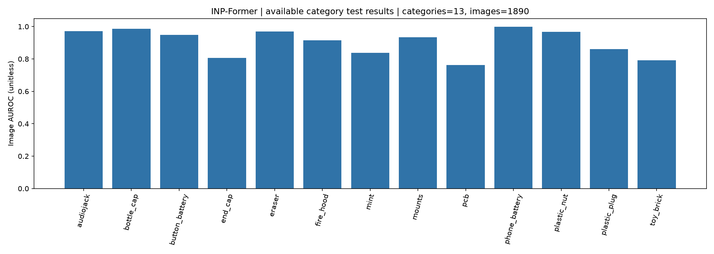

# INP-Former 모델별 종합 보고서
> **최신 상태는 18:03 KST 최종 재확인 절을 우선한다.** 최초 snapshot 이후 INP 14품목 완료, RT-DETRv2·YOLOS·ViTDet 활성화 등 변화가 있다.

확인 시점: 2026-11-19T08:15:59.013736+00:00 (UTC). 원격 학습 상태는 이후 계속 변한다. 이 보고서가 학습이나 Test 평가를 새로 실행한 것은 아니다.

## 현재 상태

**CATEGORY_TRAINING_IN_PROGRESS** — 18:03 KST 완료 영수증14/30품목. transistor1·regulator 학습 중. 로컬 집계 평가13품목 확보.

## 학습·데이터 조건

원격 주 실험 코호트는 30,000장 /6,000 선언 제품 /30품목이며 Train21,045·Validation4,400·Test4,555이다. 전체151,050장 전수 학습 결과가 아니다. v1/v2는 같은 코호트 경로를 사용해도 Crop/클래스 계약이 다를 수 있다.

|설정|관측된 값(복수 Run 포함)|
|---|---|
|official_repo|"https://github.com/luow23/INP-Former"|
|official_commit|"17d265381d9b323a2ef6e05aab0665a85edebe84"|
|manifest_sha256|"02db94ccda58921575b94d18c70d5064327c4608a9b58bfc6d78d9004f993c55"|
|split_version|"v2-preserved"|
|crop_policy_version|"provided-preprocessing-csv-saved-coordinates"|
|epochs|50|
|batch_size|16|
|optimizer|"StableAdamW"|
|learning_rate|0.001|
|input_resolution|[256, 256]|

## 확보된 평가 수치

아래는 **확보된 품목들의 category macro 평균**이다. 모든 이미지 점수를 합쳐 다시 계산한 pooled AUROC가 아니며, 서로 다른 데이터/전처리 Run 간 성능 순위를 뜻하지 않는다.

|품목 수|Test 이미지 합|Image AUROC macro|Image AP macro|Image F1 macro|Pixel AUROC macro|AUPRO macro|
|---:|---:|---:|---:|---:|---:|---:|
|13|1890|0.904011|0.815658|0.752237|0.989073|0.940320|

|품목|Val AUROC|Test AUROC|Test AP|Test F1|Pixel AUROC|AUPRO|Test n|
|---|---:|---:|---:|---:|---:|---:|---:|
|audiojack|0.949444|0.971053|0.926708|0.782609|0.998726|0.993960|115.000000|
|bottle_cap|0.988824|0.986939|0.945097|0.901408|0.996639|0.989606|140.000000|
|button_battery|0.989286|0.949333|0.920072|0.827586|0.976794|0.898663|140.000000|
|end_cap|0.849965|0.806864|0.813575|0.742424|0.968178|0.889358|130.000000|
|eraser|0.995238|0.968571|0.893314|0.876404|0.998673|0.992985|145.000000|
|fire_hood|0.968571|0.915652|0.785204|0.695652|0.996687|0.956381|145.000000|
|mint|0.931696|0.837672|0.762354|0.515152|0.964522|0.822731|150.000000|
|mounts|0.973056|0.934167|0.895839|0.810127|0.997899|0.990478|160.000000|
|pcb|0.842692|0.761513|0.774981|0.681818|0.978267|0.868725|155.000000|
|phone_battery|1.000000|0.999807|0.999517|0.988764|0.998454|0.995804|160.000000|
|plastic_nut|0.968333|0.967500|0.910611|0.857143|0.998116|0.991695|150.000000|
|plastic_plug|0.945806|0.860690|0.323918|0.500000|0.995957|0.926702|150.000000|
|toy_brick|0.838954|0.792381|0.652367|0.600000|0.989031|0.907077|150.000000|

해석: 품목별 편차가 있으며 높은 평균만으로 취약 품목의 안정성이 보장되지 않는다. 표본 수와 회복 평가 여부를 함께 확인한다.

## 체크포인트 및 로컬 수신

[전체 체크포인트 대조 CSV](CHECKPOINT_SYNC_STATUS.csv), [로컬 컨테이너 검사](LOCAL_CHECKPOINT_CONTAINER_STATUS.csv)를 참고한다. ZIP 구조 검사는 tensor 값의 유한성이나 full CRC 검사를 뜻하지 않는다. SHA 검증 파일 수는 전체 점검 보고서에 별도 기록한다.

|원격 파일|완료 epoch|step|원격 존재|로컬 동일 이름/크기|
|---|---:|---:|---|---|
|`/workspace/real-iad/outputs/remaining_models_recovery_20261117/job/inp_former/audiojack/state_bd17b94fa54244a5821021478fb1584f.pt`|50|1900|False|True|
|`/workspace/real-iad/outputs/remaining_models_recovery_20261117/job/inp_former/bottle_cap/state_921c8e5a410e4d02a4f388181fcacc2d.pt`|50|1600|False|True|
|`/workspace/real-iad/outputs/remaining_models_recovery_20261117/job/inp_former/button_battery/state_44891d53eef34e068690ebb5d630268b.pt`|50|1250|False|True|
|`/workspace/real-iad/outputs/remaining_models_recovery_20261117/job/inp_former/end_cap/state_cb45dfb29ae8481ea44b7b1c94992e3a.pt`|50|1250|False|True|
|`/workspace/real-iad/outputs/remaining_models_recovery_20261117/job/inp_former/eraser/state_aa6b214ca53b4a25a0290ba50766df8a.pt`|50|1700|False|True|
|`/workspace/real-iad/outputs/remaining_models_recovery_20261117/job/inp_former/fire_hood/state_df126aaa3d1c4bd4a99b74521ebf93c5.pt`|50|1700|False|True|
|`/workspace/real-iad/outputs/remaining_models_recovery_20261117/job/inp_former/mint/state_4a556d3b02c44ac29b44959d91ffee60.pt`|50|1600|False|True|
|`/workspace/real-iad/outputs/remaining_models_recovery_20261117/job/inp_former/mounts/state_3bc1bb8c037441a2ad92e87dc3e51187.pt`|50|1650|False|True|
|`/workspace/real-iad/outputs/remaining_models_recovery_20261117/job/inp_former/pcb/state_c17ce4521dcc4fb0b6942a80c050b50d.pt`|50|1250|False|True|
|`/workspace/real-iad/outputs/remaining_models_recovery_20261117/job/inp_former/phone_battery/state_b7fa3168ab4c4d05af68baa2e78fcf71.pt`|50|1700|False|True|
|`/workspace/real-iad/outputs/remaining_models_recovery_20261117/job/inp_former/plastic_nut/state_ec414feb86cc42039d6a61ce91b57c34.pt`|50|1900|False|True|
|`/workspace/real-iad/outputs/remaining_models_recovery_20261117/job/inp_former/plastic_plug/state_bbb54fa8cce54c4a82e8f44969b85cd1.pt`|50|2000|False|True|
|`/workspace/real-iad/outputs/remaining_models_recovery_20261117/job/inp_former/toy_brick/state_afe6836787524dadb19f89053f113889.pt`|23|792|True|False|
|`/workspace/real-iad/outputs/remaining_models_recovery_20261117/job/inp_former/porcelain_doll/state_54ce212320404ca1b2d8c78d26e79413.pt`|18|703|True|False|

## 실제 추론 시연

NOT_EXECUTED — 이 모델의 실제 추론 예시는 이번 작업에서 실행하지 않았다. 공통 CLI의 모델 이름 지원과 실제 런타임 검증은 다르다.

## 다음 학습·평가 작업

현재 두 worker를 유지하고 남은 18품목(진행 중2 포함)을 이어간다. 완료 품목을 재학습하지 않고 각 best/설정/평가를 즉시 백업한다.

## 근거 및 한계

- [원격 초기 snapshot](../../outputs/remote_training_audit_20261119_v1/remote_snapshot.json) / [원격 후속 점검](../../outputs/remote_training_audit_20261119_v1/remote_final.json) / [설정·평가 수집](../../outputs/remote_training_audit_20261119_v1/report_inputs.json)
- [품목별 수치 CSV](MODEL_METRICS.csv) / [시점별 원본 집계](VIEW_METRICS.csv)
- 기존 체크포인트/학습/원본/승인 기록은 변경하지 않았다. GPU benchmark와 전체 재평가는 NOT_EXECUTED다.

## 최종 재확인 — 2026-11-19 18:03 KST

최초 17:10~17:16 점검 이후에도 학습·수신 상태가 변했다. 아래 상태가 앞선 snapshot 설명보다 우선한다. [최신 원격 원본](../../outputs/remote_training_audit_20261119_v1/remote_refresh.json).

- 18:02 KST: A6000 GPU 99%, VRAM 45,517/49,140 MiB, 디스크 여유 약54GB. 추가 학습 worker가 기존 자동 실행기에 의해 시작됐다. 이 점검에서 시작한 작업이 아니다.
- INP-Former 완료 영수증 **14/30품목**. toy_brick·porcelain_doll도 완료했으며 현재 transistor1·regulator를 학습 중이다. 나머지16품목에는 현재 진행 중2품목이 포함된다. 로컬에서 확보한 품목별 평가 수치는 이보다 앞선 **13품목**이다.
- YOLO11 v2 저장 checkpoint **11 epoch,57,882step**. Faster R-CNN v2 **완료 epoch2,14,200step(3번째 epoch 진행)**. RetinaNet v2 **완료 epoch1,6,900step(2번째 epoch 진행)**. 진행 중 step과 완료 epoch는 구분한다.
- RT-DETRv2·YOLOS·ViTDet worker가 새로 활성화됐다. 실행 request가 snapshot 코드와 job 경로를 사용하므로 이전 v1과 동일한 클래스인지, 수정 계약인지 추가 확인 전 **클래스 계약 UNVERIFIED**다. 단순히 모두 v2로 바뀌었다고 해석하지 않는다.
- HVQ-Trans는 재시작 후 **48/50,22,801/23,950iter** 로그다. 앞서50/50로그가 있어도 최종 완료 영수증/평가가 없으며 반복 재실행 이력이 있다.
- 최초 점검 이후 로컬 INP toy_brick metrics가17:35에 추가 수신된 것도 확인했다. 따라서 최초 수신 시각16:48/프로세스 부재만으로 현재 동기화가 계속 멈췄다고 단정할 수 없다. 다만 export/offload큐에 포함되지 않은 활성 checkpoint의 자동 보존은 여전히 보장되지 않는다.

### 확인한 SHA256 범위

참조·export manifest 기반 **55건 / 고유 파일55개 / 불일치0건**이다. 이 범위의 해시는 일치한다. 별도 구조 검사에서 확인한 손상3개 파일은 이 검증 집합 밖에 있으며, 전체416개가 모두 정상이라는 뜻이 아니다.
