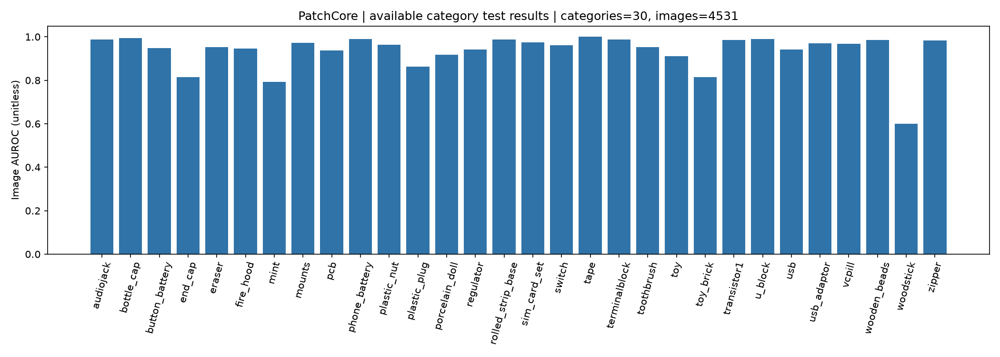

# PatchCore 모델별 종합 보고서
> **최신 상태는 18:03 KST 최종 재확인 절을 우선한다.** 최초 snapshot 이후 INP 14품목 완료, RT-DETRv2·YOLOS·ViTDet 활성화 등 변화가 있다.

확인 시점: 2026-11-19T08:15:59.013736+00:00 (UTC). 원격 학습 상태는 이후 계속 변한다. 이 보고서가 학습이나 Test 평가를 새로 실행한 것은 아니다.

## 현재 상태

**FIT_EVALUATION_COMPLETED** — 30/30 품목 메모리뱅크 fit·평가 완료. Gradient 기반 50 epoch 모델이 아님.

## 학습·데이터 조건

원격 주 실험 코호트는 30,000장 /6,000 선언 제품 /30품목이며 Train21,045·Validation4,400·Test4,555이다. 전체151,050장 전수 학습 결과가 아니다. v1/v2는 같은 코호트 경로를 사용해도 Crop/클래스 계약이 다를 수 있다.

|설정|관측된 값(복수 Run 포함)|
|---|---|
|official_repo|"https://github.com/amazon-science/patchcore-inspection"|
|official_commit|"fcaa92f124fb1ad74a7acf56726decd4b27cbcad"|
|manifest_sha256|"02db94ccda58921575b94d18c70d5064327c4608a9b58bfc6d78d9004f993c55"|
|split_version|"v2-preserved"|
|crop_policy_version|"provided-preprocessing-csv-saved-coordinates"|
|epochs|0|
|batch_size|1|
|optimizer|"NONE"|
|learning_rate|0.002|
|input_resolution|[256, 256]|

## 확보된 평가 수치

아래는 **확보된 품목들의 category macro 평균**이다. 모든 이미지 점수를 합쳐 다시 계산한 pooled AUROC가 아니며, 서로 다른 데이터/전처리 Run 간 성능 순위를 뜻하지 않는다.

|품목 수|Test 이미지 합|Image AUROC macro|Image AP macro|Image F1 macro|Pixel AUROC macro|AUPRO macro|
|---:|---:|---:|---:|---:|---:|---:|
|30|4531|0.934445|0.852563|0.761529|0.991583|0.951846|

|품목|Val AUROC|Test AUROC|Test AP|Test F1|Pixel AUROC|AUPRO|Test n|
|---|---:|---:|---:|---:|---:|---:|---:|
|audiojack|0.932037|0.988421|0.963051|0.904762|0.999137|0.994980|115.000000|
|bottle_cap|0.993824|0.994286|0.978450|0.944444|0.998924|0.995809|140.000000|
|button_battery|0.986286|0.947778|0.914043|0.700000|0.988746|0.899721|140.000000|
|end_cap|0.836912|0.814438|0.848544|0.742138|0.964268|0.868104|130.000000|
|eraser|0.982857|0.953095|0.896277|0.790698|0.997836|0.987677|145.000000|
|fire_hood|0.931429|0.946377|0.848443|0.674419|0.995974|0.953177|145.000000|
|mint|0.914620|0.791958|0.670859|0.597403|0.977099|0.837749|150.000000|
|mounts|0.985833|0.973125|0.935443|0.811594|0.998763|0.991822|160.000000|
|pcb|0.881154|0.937983|0.942366|0.813008|0.996100|0.946190|155.000000|
|phone_battery|0.993250|0.989565|0.974038|0.876404|0.997426|0.973880|160.000000|
|plastic_nut|0.905417|0.963889|0.877937|0.745763|0.998406|0.992797|150.000000|
|plastic_plug|0.797419|0.863448|0.414401|0.285714|0.991838|0.910670|150.000000|
|porcelain_doll|0.976522|0.917818|0.651998|0.604651|0.998268|0.989938|190.000000|
|regulator|0.977667|0.940741|0.658316|0.461538|0.999087|0.992633|145.000000|
|rolled_strip_base|1.000000|0.988667|0.989228|0.935065|0.997522|0.988161|155.000000|
|sim_card_set|0.997436|0.973517|0.946266|0.967213|0.998012|0.984983|139.000000|
|switch|0.973455|0.960714|0.862414|0.786885|0.995417|0.975392|155.000000|
|tape|0.990000|1.000000|1.000000|0.975610|0.999619|0.998652|145.000000|
|terminalblock|0.989107|0.988222|0.974701|0.903226|0.998617|0.993938|145.000000|
|toothbrush|0.964691|0.952632|0.885114|0.776471|0.990507|0.952645|148.000000|
|toy|0.823320|0.911624|0.876639|0.791946|0.977284|0.902825|155.000000|
|toy_brick|0.762353|0.815450|0.731996|0.556962|0.988295|0.900063|150.000000|
|transistor1|0.994343|0.985714|0.939798|0.904110|0.998720|0.992322|155.000000|
|u_block|0.991034|0.990000|0.941587|0.791667|0.999480|0.997217|150.000000|
|usb|0.970455|0.941217|0.855779|0.800000|0.995635|0.966816|165.000000|
|usb_adaptor|0.838496|0.969938|0.913691|0.837838|0.997346|0.981418|150.000000|
|vcpill|0.930833|0.966852|0.939165|0.880000|0.995797|0.973616|175.000000|
|wooden_beads|0.906400|0.984914|0.972432|0.793103|0.991832|0.918441|160.000000|
|woodstick|0.529000|0.598860|0.204947|0.304348|0.923487|0.707797|157.000000|
|zipper|0.997222|0.982115|0.968968|0.888889|0.998060|0.985959|152.000000|

해석: 품목별 편차가 있으며 높은 평균만으로 취약 품목의 안정성이 보장되지 않는다. 표본 수와 회복 평가 여부를 함께 확인한다.

## 체크포인트 및 로컬 수신

[전체 체크포인트 대조 CSV](CHECKPOINT_SYNC_STATUS.csv), [로컬 컨테이너 검사](LOCAL_CHECKPOINT_CONTAINER_STATUS.csv)를 참고한다. ZIP 구조 검사는 tensor 값의 유한성이나 full CRC 검사를 뜻하지 않는다. SHA 검증 파일 수는 전체 점검 보고서에 별도 기록한다.

전용 체크포인트 참조를 이번 snapshot에서 확보하지 못했거나 이미 offload되어 원본 참조가 남아 있지 않다. 해당 상태를 가중치 부재로 단정하지 않는다.

## 실제 추론 시연

NOT_EXECUTED — 이 모델의 실제 추론 예시는 이번 작업에서 실행하지 않았다. 공통 CLI의 모델 이름 지원과 실제 런타임 검증은 다르다.

## 다음 학습·평가 작업

새 학습보다 메모리뱅크·설정·평가 결과 묶음 보존 및 재현 추론을 우선한다.

## 근거 및 한계

- [원격 초기 snapshot](../../outputs/remote_training_audit_20261119_v1/remote_snapshot.json) / [원격 후속 점검](../../outputs/remote_training_audit_20261119_v1/remote_final.json) / [설정·평가 수집](../../outputs/remote_training_audit_20261119_v1/report_inputs.json)
- [품목별 수치 CSV](MODEL_METRICS.csv) / [시점별 원본 집계](VIEW_METRICS.csv)
- 기존 체크포인트/학습/원본/승인 기록은 변경하지 않았다. GPU benchmark와 전체 재평가는 NOT_EXECUTED다.